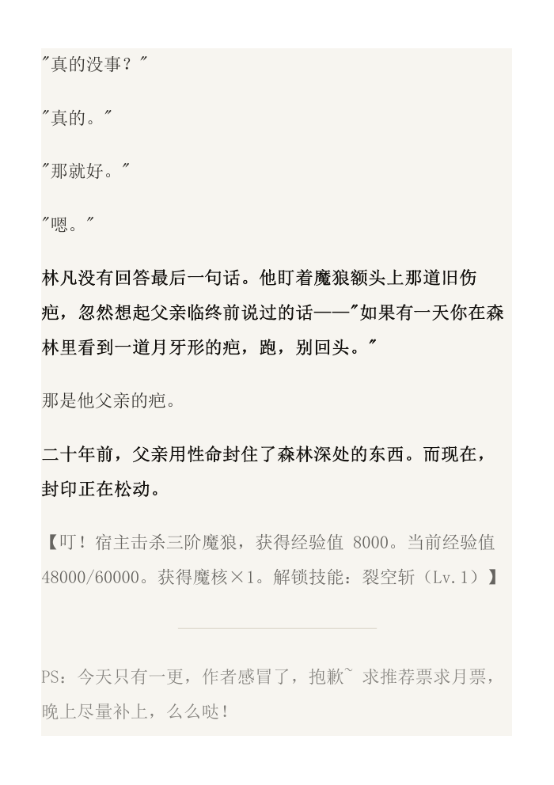

# webnovel-focus · 网文分级渲染

把中文网文正文（TXT）做成"分级渲染版"：**关键情节加深、注水淡化、求票与作者话这类噪音判死**。
输出三种载体：自带阅读器的 HTML、可导入阅读器的 EPUB、可直接打印的 PDF。



上图是 `samples/demo.txt` 的 PDF 输出：加粗变深的是关键情节，变浅的是系统面板与章末作者话。

## 它解决什么

网文动辄几百万字，大量篇幅对追主线的人是噪音。这个 skill 逐段判定分层，把注意力还给情节，
而"什么算水"最终由读者的偏好决定，不由引擎替他下结论。

| 层级 | 例子 | 处置 |
|---|---|---|
| 零信息 | 求票、请假条、平台水印、盗版广告、整块复述 | 引擎判死，与偏好无关 |
| 非情节信息 | 系统面板数值、写景、招式细节、日常对话 | 只打中立标签，处置权在读者 |
| 情节 | 转折、伏笔、关系变化、事件结果、异常字段 | 永远保护并加深 |

引擎只做识别：输出 `{区间, 类型, 证据, 分数}`，处置由偏好层决定。所以**识别一次、渲染无数次**
——在页面里拖滑杆不重跑判定。

## 安装

把 `webnovel-focus/` 整个目录放进 Codex 的技能目录（`$CODEX_HOME/skills`，未设置时是 `~/.codex/skills`）：

```powershell
git clone https://github.com/<你的用户名>/webnovel-focus.git
Copy-Item -Recurse .\webnovel-focus\webnovel-focus "$env:USERPROFILE\.codex\skills\webnovel-focus"
```

```bash
# macOS / Linux
git clone https://github.com/<你的用户名>/webnovel-focus.git
cp -R webnovel-focus/webnovel-focus ~/.codex/skills/webnovel-focus
```

装好后**新开一个对话**（技能列表在会话开始时加载），用自然语言触发（"这书太水，我只想看剧情，
文件在 …"）或显式 `$webnovel-focus`。

## 快速上手

```bash
# 1. 新书第一次用：源文件体检（防盗版反义词替换、?? 替换、章号异常）+ 风格基线 + 前几章抽查页
python scripts/run.py doctor 书名.txt

# 2. 出阅读版：parse → detect → report → render；超过 40 万字自动分章
python scripts/run.py build 书名.txt

# 3. 交付给读者
python scripts/run.py export build/书名/analyzed.json --format epub
python scripts/run.py export build/书名/analyzed.json --format pdf --chapters-per-file 50
```

判定不准时：

```bash
python scripts/run.py sample build/书名/analyzed.json --tier fade --n 25 --context 1
```

## 依赖

- Python 3 + Jinja2（渲染）。**EPUB 打包零依赖**，纯 zipfile 手写 XHTML。
- scikit-learn 可选：只用于重复段落检测，缺了自动跳过，其余判定不受影响。
- PDF 需要本机有 Edge 或 Chrome（无头打印）。不需要 WeasyPrint / calibre / pandoc。
- 不需要 jieba：中文查重用 sklearn 的字符级 n-gram。

## 目录

```
webnovel-focus/            技能包本体（自包含，可整体拷走）
├── SKILL.md               触发条件、核心流程、决策点
├── scripts/
│   ├── run.py             唯一入口：doctor / build / sample / export
│   ├── prescan.py         源文件体检 + 风格基线
│   ├── parse.py           TXT → 章节 / 段落 / 字符偏移
│   ├── detect_rules.py    规则层：零信息判定、结构与风格标签、关键锚点
│   ├── tiers.py           kind + score → 分层（引擎与渲染共用）
│   ├── render.py          渲染 HTML（单文件 / 分章 / 打印用）
│   ├── pack_epub.py       打包 EPUB（真淡化）
│   ├── pack_pdf.py        打包 PDF（无头浏览器）
│   ├── make_css_probe.py  生成样式探针 EPUB，实测阅读器保留哪些样式
│   ├── report.py          逐段对照表
│   └── eval.py            按固定种子抽样审查
├── references/            判定标准 / 载体与处置规格 / 评估方法
├── assets/reader.html.j2  阅读器模板
└── tests/check_pack.py    打包自检（EPUB 结构 + PDF 墨色实测）
DESIGN.md                  设计决策与里程碑
FINDINGS.md                在两本真书上调试出的运行期约束（哪些规则被证伪）
samples/demo.txt           合成样本：3 章，含面板、作者话、写景、标点连打
docs/demo-page.png         README 的效果图
```

## 已知边界

- 输入是纯文本 TXT；EPUB / HTML 需要先抽成文本（HTML 源更好切分：作者话、水印常是独立节点）。
- 判定是**纯本地规则层**，没有接入 LLM 语义打分。模糊区靠"只打标签 + 读者手动纠错"兜住，
  代价是零成本、可复现、离线可跑。
- 微信读书、起点 App 不允许自定义样式，也不吃本地 EPUB；EPUB 面向 Apple Books、静读天下、
  多看、Calibre 这类能导入文件的阅读器。导入后灰色若被抹平，用 `scripts/make_css_probe.py`
  实测该阅读器保留哪些样式，再决定 `--lever color|opacity`。
- 大书不要打成一个 PDF（369 万字约上万页），用 EPUB 或 `--chapters-per-file` 拆卷。

## 许可

本仓库尚未指定开源许可。未指定意味着默认保留所有权利：可以读、可以本地用，
但他人不能合法地复制、修改、再分发。希望放开的话，加一份 `LICENSE`（MIT 最省事）。
